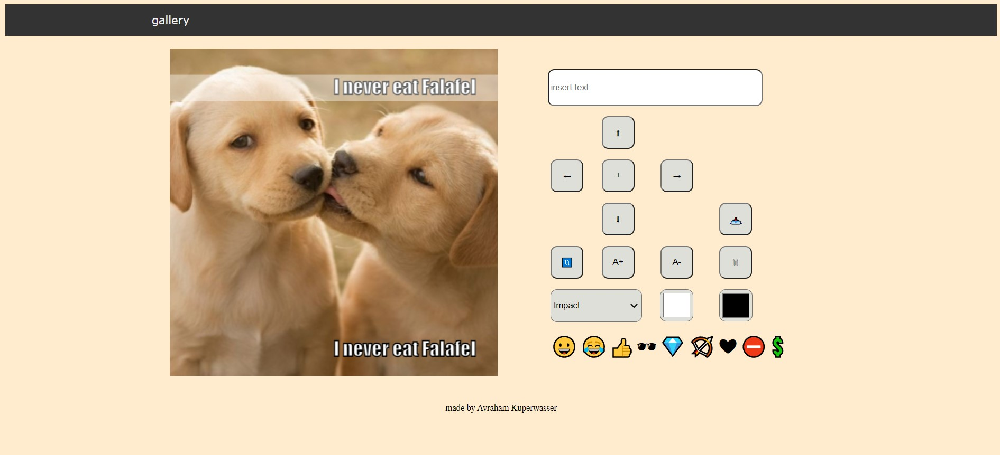

# Meme Generator

A meme editor that runs entirely in the browser: pick an image from the gallery, add text and stickers, style it and download the result.

**[▶ Try the live demo](https://avraham186.github.io/memGen/)**

## Features

- Image gallery to choose a template from
- Multiple text lines: add, remove, switch between them and move them on the image
- Font family, font size, fill and stroke colors
- Emoji stickers
- Download the finished meme as an image

## Tech

- Vanilla JavaScript with an MVC-style split (`memeService`, `memeController`, `galleryController`)
- HTML5 Canvas for drawing images and text
- CSS3

## Run locally

No build step: clone the repo and open `index.html` in a browser.
